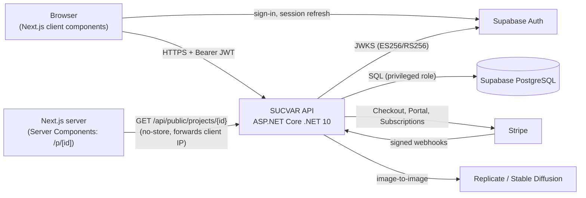
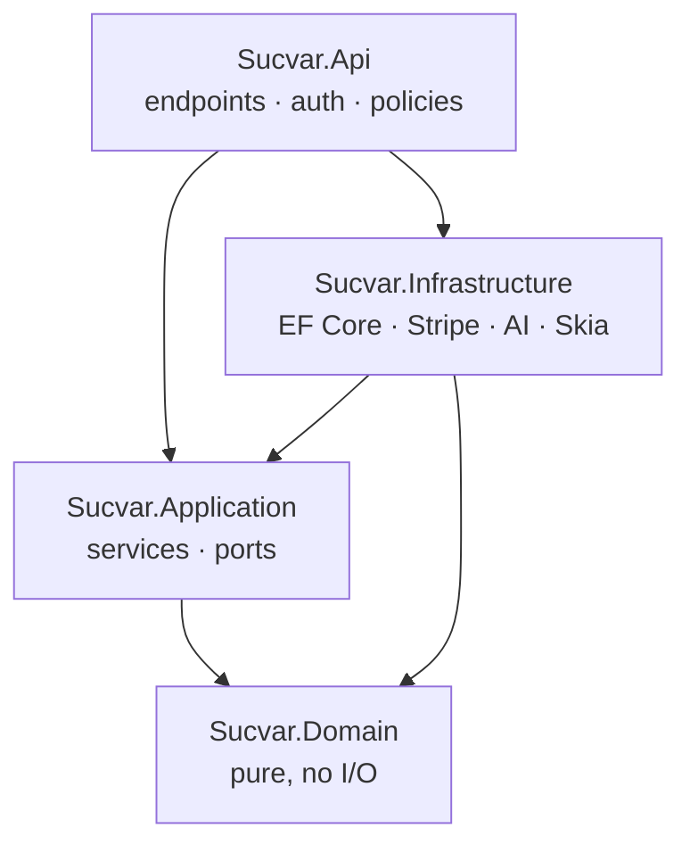
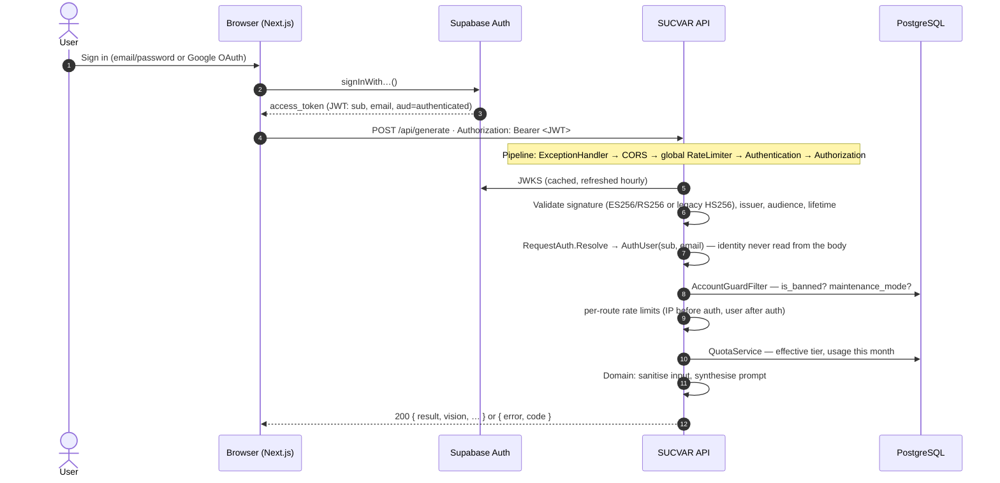
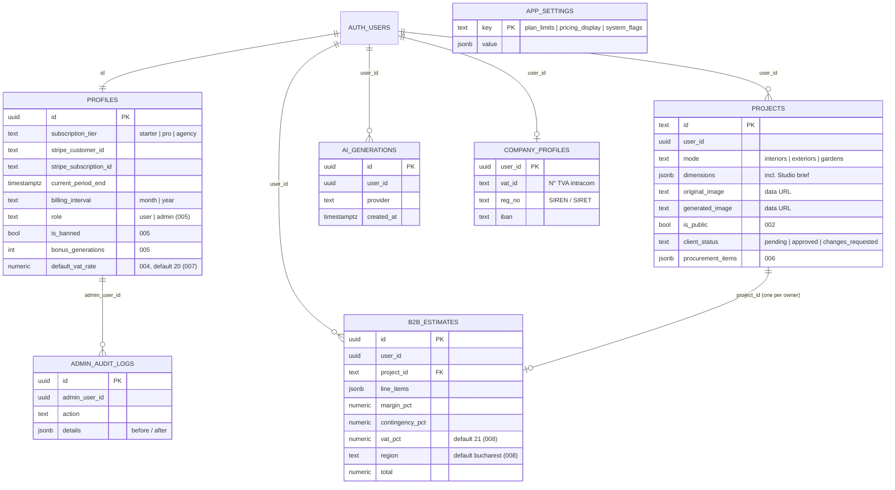
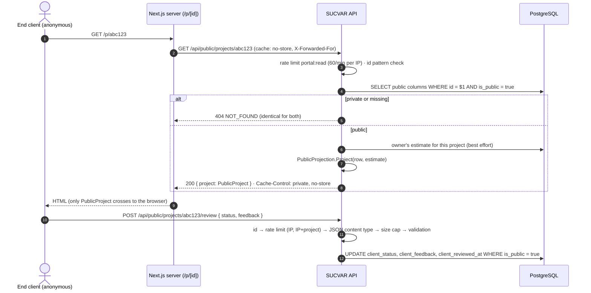
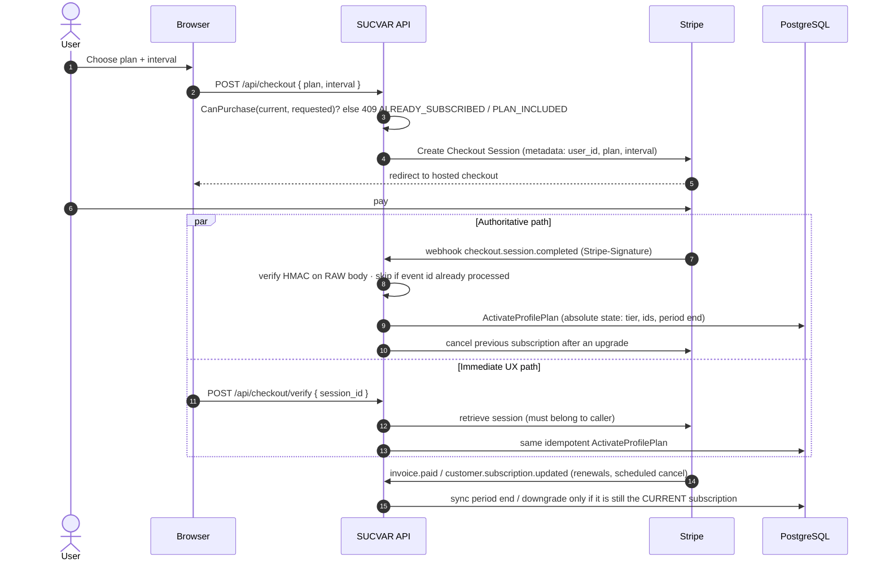
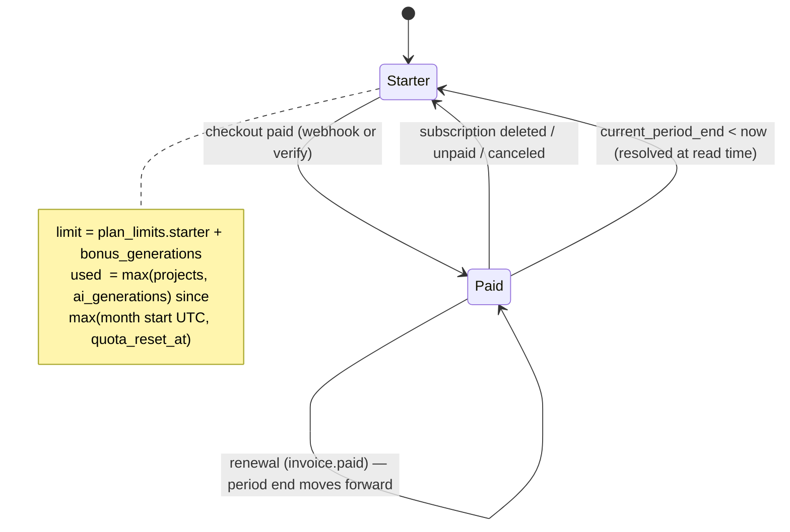

# SUCVAR — Architecture

SUCVAR is an AI interior / exterior / garden design studio for the Romanian renovation market.
A user uploads a photo of a space, describes the result they want, and receives an AI redesign together with an
engineering take-off (areas, paint, lighting), a priced bill of materials linked to Romanian retailers (Dedeman, Leroy Merlin, Hornbach, IKEA…), and — on the
agency plan — a professional *devis* (quote) that can be shared with the end client for approval.

This document describes how the system is built and why. For setup instructions see [README.md](README.md).

---

## Contents

1. [System overview](#1-system-overview)
2. [Backend — Clean Architecture](#2-backend--clean-architecture)
3. [Frontend — Next.js 16](#3-frontend--nextjs-16)
4. [Request lifecycle and Supabase JWT authentication](#4-request-lifecycle-and-supabase-jwt-authentication)
5. [Data model and multi-tenant isolation](#5-data-model-and-multi-tenant-isolation)
6. [Public client portal — security projection](#6-public-client-portal--security-projection)
7. [Billing — Stripe webhooks and quota lifecycle](#7-billing--stripe-webhooks-and-quota-lifecycle)
8. [Administration and moderation](#8-administration-and-moderation)
9. [Romanian market localisation and quote rules](#9-romanian-market-localisation-and-quote-rules)
10. [Cross-cutting concerns](#10-cross-cutting-concerns)
11. [Quality strategy](#11-quality-strategy)
12. [Known limitations and evolution path](#12-known-limitations-and-evolution-path)

---

## 1. System overview

| Part | Technology | Responsibility |
|---|---|---|
| `frontend/` | Next.js 16 (App Router), React 19, Tailwind 4 | UI only. No API routes, no server secrets. Talks to the API over HTTPS and to Supabase Auth for sign-in. |
| `backend/` | ASP.NET Core Web API on .NET 10, EF Core 10 + Npgsql | All business rules, authorisation, quota, billing and AI orchestration. |
| Database | Supabase PostgreSQL | Schema owned by hand-written SQL migrations (`backend/db/migrations`). |
| Identity | Supabase Auth | Issues the JWT access tokens the API validates. |
| Payments | Stripe Checkout, Customer Portal, webhooks | Subscriptions for the *Professional* and *Business* plans. |
| AI | Replicate or a self-hosted Stable Diffusion endpoint (demo provider as fallback) | Image-to-image redesign. |



**Design principle — a thin client and an authoritative server.** The frontend mirrors some pure rules
(catalog, engineering formulas, plan tiers) so the UI can react instantly, but every decision that has a cost or a
security impact — quota, plan entitlement, pricing projection, admin rights — is re-evaluated by the API on each
request. A tampered browser can only change what it *displays*.

---

## 2. Backend — Clean Architecture

```
backend/
├── src/
│   ├── Sucvar.Domain/          pure rules: plans, catalog, engineering, prompts, BOM, devis, public projection
│   ├── Sucvar.Application/     use cases + ports (repository / gateway interfaces)
│   ├── Sucvar.Infrastructure/  adapters: EF Core/Npgsql, Stripe.net, AI providers, SkiaSharp
│   └── Sucvar.Api/             composition root: endpoints, JWT auth, policies, rate limiting, hosting
├── tests/Sucvar.Tests/         xUnit: unit, golden-parity and HTTP integration tests
└── db/                         SQL migrations 001–007 + setup_all.sql
```



Dependencies only point inwards. `Sucvar.Domain` references nothing but the BCL; `Sucvar.Application` declares the
ports it needs (`ISubscriptionRepository`, `IStripeGateway`, `IImageProvider`, …) and `Sucvar.Infrastructure`
implements them. `Sucvar.Api` is the only project that knows all layers, because it is the composition root.

| Layer | Key types | Notes |
|---|---|---|
| Domain | `PlanTiers`, `SucvarCatalog`, `Engineering`, `GenerationPrompt`, `BomBuilder`, `RomanianRetail`, `EstimateParser`, `PublicProjection`, `IsoTime`, `Js` | Deterministic, side-effect free. `Js` reproduces JavaScript number semantics so the C# port of the original TypeScript rules is byte-identical (verified by golden tests). |
| Application | `QuotaService`, `SubscriptionService`, `CheckoutService`, `StripeWebhookProcessor`, `EstimateService`, `PortalService`, `ProfileService`, `ProcurementService`, `AdminService`, `PlatformSettingsService` | Orchestrates domain rules and ports. Throws `AppException(status, code, message)` for expected failures. |
| Infrastructure | `SucvarDbContext`, repositories, `ProjectSql`, `PgErrors`, `StripeGateway`, `ImageProviderSelector`, `SkiaImageProcessor` | Maps PostgreSQL error states to stable API codes (e.g. undefined table ⇒ 503 `MIGRATION_REQUIRED`). |
| Api | `StudioEndpoints`, `BillingEndpoints`, `B2bEndpoints`, `PortalEndpoints`, `ProfileEndpoints`, `AdminEndpoints`, `RequestAuth`, `AdminAuthorizationHandler`, `AccountGuardFilter`, `FixedWindowRateLimitStore` | Minimal APIs grouped per bounded area. |

**Error contract.** Every error body is `{ "error": string, "code": string, ...extra }`. `AppException` carries the
status and code; `HttpHelpers.HandleError` maps it in endpoint `catch` blocks, and the global exception handler
covers anything that escapes, so stack traces and SQL details never reach a client.

**Schema ownership.** EF Core is used for typed queries only; it never generates or runs migrations. The SQL files
in `backend/db/migrations` are the single source of truth. Every column is mapped explicitly (`HasColumnName`,
`HasColumnType`) on top of the `snake_case` naming convention so that schema drift fails loudly.

---

## 3. Frontend — Next.js 16

```
frontend/app/
├── (routes)          /, /generate, /b2b, /account, /login, /admin, /checkout, /p/[id], legal pages
├── components/       feature folders: studio, b2b, home, portal, account, admin, login, layout, ui
├── lib/              api-client, i18n, plan, studio, b2b, portal, profile, admin, supabase, theme
├── data/             catalog, spaces, style specs, landing copy (mirrored by the backend's catalog.json)
└── types/            shared domain types (barrel: @/app/types)
```

* **Single API gateway.** All HTTP calls go through `lib/api-client.ts` (`apiFetch`, `readJson`, `apiJson`,
  `ApiError`). It chooses the base URL (`NEXT_PUBLIC_API_URL` in the browser, `API_INTERNAL_URL` on the server),
  attaches the Supabase bearer token and normalises ASP.NET `ProblemDetails` into `{ error, code }`.
* **Pages orchestrate, components render.** Large pages keep the state machine and async flows; visual sections
  are controlled components (`components/studio/PhotoSection`, `components/b2b/PricingConsole`,
  `components/home/PricingSection`, …) and pure calculations live in `lib/studio/studioHelpers.ts`,
  `data/catalog.ts` and `lib/b2b/estimate.ts`.
* **Client-side plan logic is advisory.** `usePlan`, `useEnterpriseAccess`, `useAccountRole` drive badges, gates and
  disabled buttons; the API enforces the same rules.
* **Public portal is server-rendered.** `/p/[id]` is a Server Component that fetches with `cache: 'no-store'` so that
  revoking a link takes effect on the very next request, forwards the visitor IP for rate limiting, and ships only
  the already-sanitised `PublicProject` to the browser.
* **Monochrome design tokens.** `lib/theme/tokens.ts` and `lib/theme/skin.ts` define the *Pure Monochrome
  Scandinavian Gallery* palette — light `#FFFFFF` / `#F5F5F5` / `#111111`, dark `#0B0B0C` / `#141416` / `#F5F5F5`,
  no blue accent. Class names are spelled out in full because Tailwind cannot see interpolated class names.
* **Anchors under a sticky header.** Anchor targets carry `scroll-mt-24`; `lib/scroll.ts` measures the real header
  height (including iOS safe-area) and re-aligns after `scrollend`, so sections land cleanly even after late layout
  shifts.

---

## 4. Request lifecycle and Supabase JWT authentication



Engineering decisions worth noting:

* **`MapInboundClaims = false`.** The default JWT handler renames `sub` to a long `ClaimTypes` URI. The API reads
  Supabase's raw claim names everywhere, so the mapping is disabled once, centrally.
* **Two signing modes at once.** Asymmetric keys come from the project's JWKS endpoint; a legacy shared HS256 secret
  is accepted when configured. If the JWKS endpoint is unreachable the retriever logs and returns an empty key set
  rather than failing startup.
* **Explicit error states.** Endpoints call `RequestAuth.Require` instead of a blanket `RequireAuthorization()` so the
  frontend can distinguish *no token* (401 `AUTH_REQUIRED`), *bad token* (401 `AUTH_INVALID`) and *server not
  configured* (500 `NOT_CONFIGURED`).
* **Trusted client IP.** `X-Forwarded-For` is honoured only when the TCP peer is a configured proxy
  (`Proxy:KnownProxies`), otherwise a caller could rotate fake IPs to escape rate limits.

---

## 5. Data model and multi-tenant isolation



**Tenant isolation is enforced twice.**

1. **Row Level Security** is enabled on every table. Authenticated users may only read (and for `projects` /
   `b2b_estimates`, write) rows where `user_id = auth.uid()`. `admin_audit_logs` and `app_settings` revoke all access
   from `anon` and `authenticated`. This protects the direct browser → Supabase paths (project archive).
2. **Explicit ownership filters in the API.** The API connects with a privileged role, which bypasses RLS by design.
   Every repository method therefore takes the caller's `Guid` (from `AuthUser.Id`, i.e. the JWT `sub`) and filters
   on `user_id` in SQL. There is no code path where a user id is taken from a request body.

**Migrations** (`backend/db/migrations`, all idempotent): `001` core schema + RLS · `002` public portal columns ·
`002b` Stripe billing period · `003` company profile · `004` profile details & B2B defaults · `005` admin panel
(roles, bans, audit log, settings) · `006` persisted procurement list · `007` French market defaults (superseded) · `008` Romanian market defaults (VAT 21 %, `bucharest`, RON).
`setup_all.sql` concatenates all of them and ends with a verification query.

**Graceful degradation.** The API detects missing tables/columns (`PgErrors.IsMissingTable/Column`) and either
falls back to defaults (e.g. settings, sharing list with `migrated: false`) or answers 503 `MIGRATION_REQUIRED`, so a
partially migrated database never produces opaque 500s.

---

## 6. Public client portal — security projection

A professional can publish a project at `/p/{id}` for their client to review and approve, without the client
needing an account. This is the only anonymous data read in the system, so it is deliberately narrow.



**What the projection guarantees** (`Sucvar.Domain.Portal.PublicProjection`):

| Exposed to the client | Never exposed |
|---|---|
| Title, mode, space, style, room dimensions, before/after images | `user_id`, owner e-mail, Stripe identifiers |
| Material list with **final** unit prices (purchase price × (1 + contingency) × (1 + margin)) | Purchase prices, margin %, contingency %, rate overrides |
| Labour, VAT and total (TTC) | Internal notes, scope breakdown, client contact data |
| Retailer links rebuilt server-side from the item query | Any URL stored in JSON (prevents link injection) |
| The cleaned design brief | The raw Studio parameters |

Additional properties: private and missing projects return an identical 404 (no id probing); the uplift factor is
capped so materials can never exceed the net amount of a stale quote; client feedback is stripped of control
characters and limited to 500 characters; only `client_*` columns of public projects can be written anonymously.

---

## 7. Billing — Stripe webhooks and quota lifecycle

**Plans.** `starter` (free, 3 generations per UTC month), `pro` *Professional* (29 €/month), `agency` *Business*
(79 €/month, unlocks the B2B portal). Annual billing = 12 × monthly − 20 %. Limits, displayed prices and flags can be
changed at runtime from `/admin` (`app_settings`, cached 30 s per instance).



**Idempotency** has three layers: (1) the processor remembers handled event ids (48 h); (2) handlers write absolute
state, never increments, so a replay is harmless; (3) downgrades apply only when the event's subscription is still the
profile's current one, so an out-of-order `deleted` event for a superseded subscription cannot cancel a newer plan.
Failures return 500 on purpose so Stripe retries.

**Effective tier and quota.**



* The **effective** tier is computed on every read (`PlanTiers.ResolveEffectiveTier`): an expired paid plan behaves
  as `starter` even if a webhook was missed.
* `SubscriptionService` **fails safe**: if the plan cannot be read, starter rules apply.
* `QuotaService` **fails closed**: if usage cannot be counted the generation is refused (500 `QUOTA_CHECK_FAILED`).
* A generation is journaled in `ai_generations` only after the provider returned an image; rejected requests are free.

---

## 8. Administration and moderation

* **Authorisation.** `/api/admin/**` requires the `AdminOnly` policy. `AdminAuthorizationHandler` re-reads
  `profiles.role` and `is_banned` from PostgreSQL **on every request** — the role is never embedded in the JWT, so a
  demotion or ban takes effect immediately rather than when the token expires.
* **Account guard.** `AccountGuardFilter` blocks banned users (403 `ACCOUNT_BANNED`) and, in maintenance mode, everyone
  but admins (503 `MAINTENANCE`) on product routes. It deliberately does **not** guard profile, billing portal,
  checkout verification or the webhook: a suspended user can still see why and cancel, and a payment already taken is
  always honoured.
* **Audit.** Every admin mutation (plan grant, quota adjustment, role change, ban, unpublish, settings change) is
  written with its `admin_audit_logs` row(s) in a single transaction, including before/after values.
* **Self-protection.** An admin cannot ban or demote themself (400 `SELF_PROTECTION`), so the platform cannot be left
  without the administrator performing the action.

---

## 9. Romanian market localisation and quote rules

**Languages.** Romanian is the default (`DEFAULT_LANGUAGE = 'ro'`), with English and French one click away.
Call sites write `t(ro, en, fr?)`; French resolves from the explicit argument, then from the dictionary keyed by the
English source string (`lib/i18n/fr.ts`), then from numeric patterns for API strings (`lib/i18n/patterns.ts`), and
finally falls back to English. Dates and numbers use `ro-RO` formatting.

**Currency.** Every stored and computed amount (catalog, bill of materials, quotes, API payloads, database) stays in
**EUR** — no data was rewritten. The UI *displays* lei, converting with one fixed rate `EUR_TO_RON` in
`frontend/app/lib/format.ts` (`formatLei`, `toRon`, `fromRon`); editable B2B prices are typed in lei and stored back in
EUR. CSV / CII exports are in RON. Subscription prices stay in € (Stripe charges EUR).

**VAT (TVA).**

| Rate | Use | Where |
|---|---|---|
| **21 %** | *Cota standard* (since 1 Aug 2025) — default for every new quote and profile | `DEFAULT_VAT`, migration `008`, `EstimateParser.DefaultVatPct`, `EstimateDefaults.VatPct` |
| **11 %** | *Cota redusă* | one-click preset (`VAT_PRESETS`, `EstimateParser.RomanianVatRates`) |
| custom | any value 0–100 % | numeric field, clamped server-side |

**Devis calculation** (`/b2b`, mirrored by the public projection):

```
hours[trade] = scope m²[trade] × hours/m²[trade] × finish-level coefficient
labour      = Σ hours[trade] × hourly rate[trade]   — regional rate unless overridden
base        = labour + Σ (qty × purchase price)            — HT, before uplift
contingency = base × contingency %          (0–15 %)
subtotal    = base + contingency
margin      = subtotal × margin %           (10–25 %)
net (HT)    = subtotal + margin
TVA         = net × VAT %
total (TTC) = net + TVA
schedule    = ⌈ Σ hours ÷ (crew × 8 h) ⌉ working days
```

Regional labour rates cover București – Ilfov, Vest, Centru / Nord and Sud / Est; `bucharest` is the default region
(migration `008`). The Paris regions remain selectable for quotes saved before the switch.

**Company identity.** Romanian CUI / RO VAT codes are checked with the ANAF control digit (migration 003). Kept as
optional extras: `vat_id` = *N° TVA intracommunautaire* (FR + 2-character key + SIREN, key verified as
`(12 + 3 × (SIREN mod 97)) mod 97`), `reg_no` = SIREN (9 digits) or SIRET (14 digits) validated with Luhn (with the
La Poste exception), IBAN validated with ISO 13616 mod-97 (27 characters for FR). Exports: CSV and Factur-X CII XML
(EN 16931) for embedding in a PDF/A-3 by an invoicing system.

**Retailers.** Each bill-of-materials line gets search links to Romanian retailers, chosen by *lane*
(`RomanianRetail.cs`, mirrored by `lib/retailers.ts`). The stored Romanian `query` is used verbatim in the URL, and
links are always rebuilt from it (stored URLs are never echoed), so older saved projects show the new links too.

| Lane | Retailers (in order) |
|---|---|
| trade materials | Dedeman · Hornbach · Brico Dépôt |
| finishes | Dedeman · Leroy Merlin · Hornbach |
| furniture | IKEA România · Mobexpert · Dedeman |
| lighting | IKEA România · Dedeman · Leroy Merlin |
| outdoor trade / outdoor | Dedeman · Brico Dépôt · Hornbach / Dedeman · Leroy Merlin · Hornbach |

Prices are indicative shelf averages scaled by budget and style, not live retailer prices.

---

## 10. Cross-cutting concerns

| Concern | Implementation |
|---|---|
| Rate limiting | Global fixed window per IP (600/min) as a safety net, plus per-route rules from the original contract (e.g. `generate:user` 6/min, `portal:review:project` 3/10 min). |
| Body limits | Read with a hard cap: declared `Content-Length` first, then actual bytes (413 `PAYLOAD_TOO_LARGE`). |
| Image safety | Data-URL format checked without regex over 6 MB; header-only inspection (64–8192 px, ≤ 40 MP); re-encoded to a permanent JPEG (≤ 1280 px). |
| Outbound resilience | `Microsoft.Extensions.Http.Resilience`; retries disabled for unsafe methods so a retried POST to the AI provider can never bill twice. |
| Configuration | `.env` loader for development, legacy variable aliases, startup guards that refuse unsafe production settings (anonymous generation, wildcard CORS, trust-all proxies). |
| Observability | Serilog request logging, `/health` with configuration and PostgreSQL checks (never prints secret values). |
| API documentation | OpenAPI + Scalar UI in Development (`/scalar/v1`). |
| Timestamps | One wire format (`IsoTime.Format`, PostgREST `timestamptz` shape) across all responses. |

---

## 11. Quality strategy

* **Golden parity tests.** The domain rules were ported from the original TypeScript implementation. Fixtures
  generated by executing the original code (`backend/tools/golden`) are replayed against the C# port, guaranteeing
  identical prompts, bills of materials and estimates.
* **Unit and HTTP tests.** xUnit covers quota, Stripe webhook idempotency and ordering, portal projection and review
  validation, admin rules (self-protection, audit atomicity), Romanian retailers and VAT defaults (`RomanianMarketTests`), image validation and
  client-IP trust. `WebApplicationFactory` tests exercise the real pipeline with in-memory fakes.
* **Build hygiene.** `backend/Directory.Build.props` treats nullable-reference warnings as errors and validates XML
  documentation; the frontend is checked with TypeScript strict mode and ESLint (Next core-web-vitals + TypeScript).

---

## 12. Known limitations and evolution path

| Area | Current state | Next step at scale |
|---|---|---|
| Rate limits, webhook idempotency, settings cache | In-memory, per API instance | Redis (or PostgreSQL) shared store when running more than one instance; the handlers are already idempotent. |
| Images | Stored as data URLs in `projects` | Object storage (Supabase Storage / S3) with signed URLs; the API already normalises images to a single JPEG format. |
| AI generation | Synchronous request (≤ 80 s budget) | Background job + polling or webhooks from the provider. |
| Retail prices | Indicative averages | Retailer APIs or periodic price feeds. |
