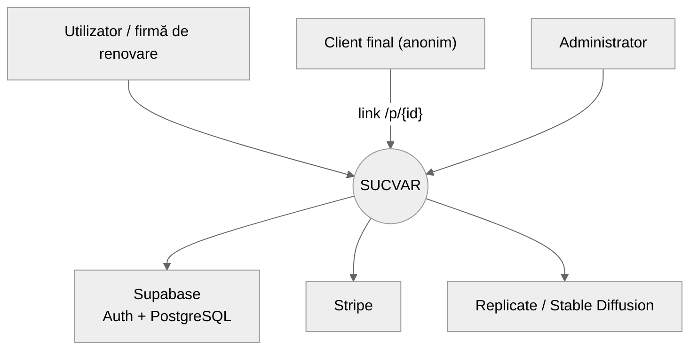
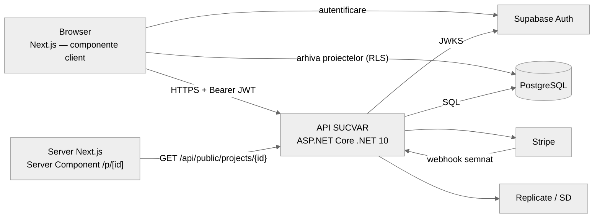
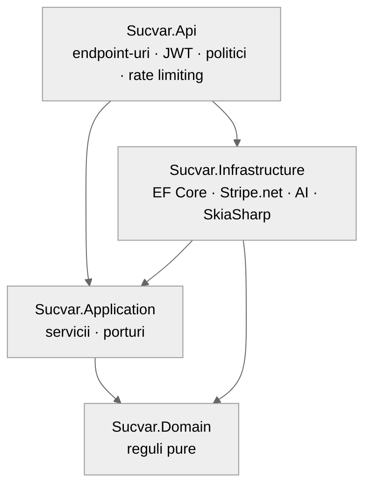
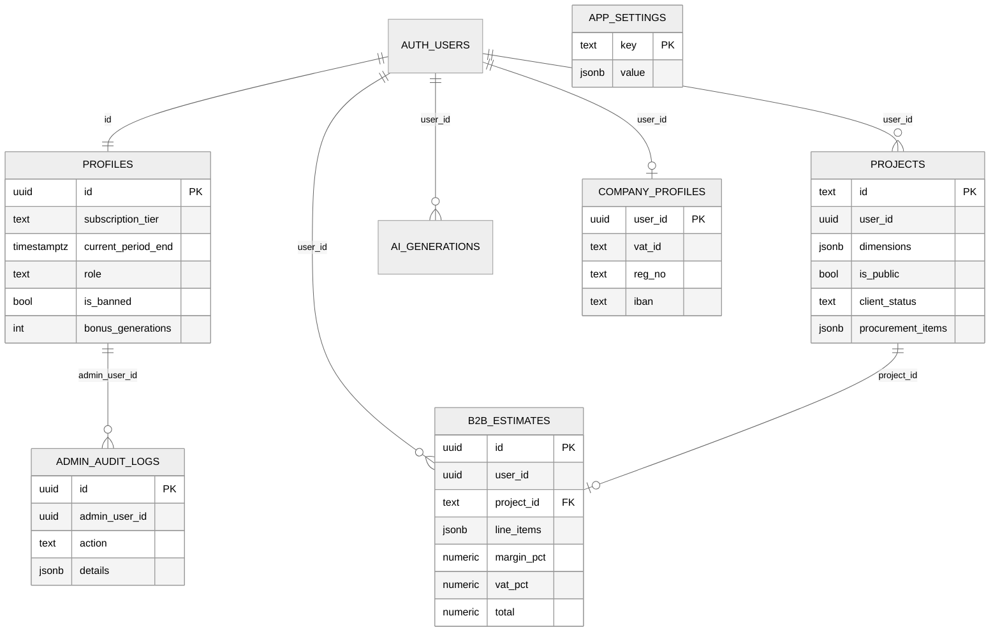
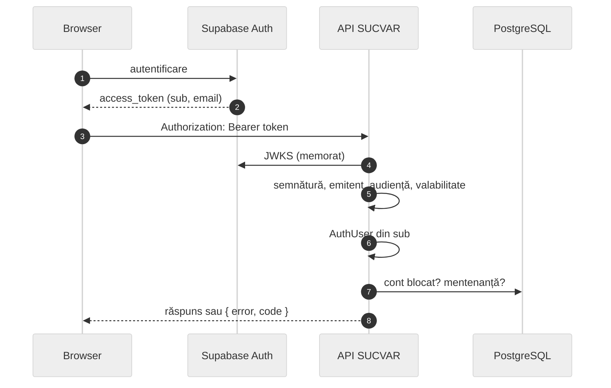
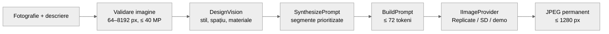
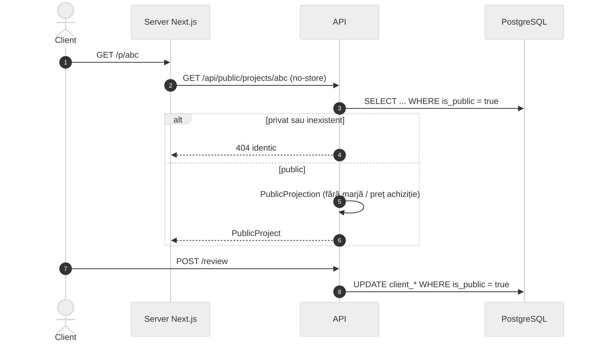
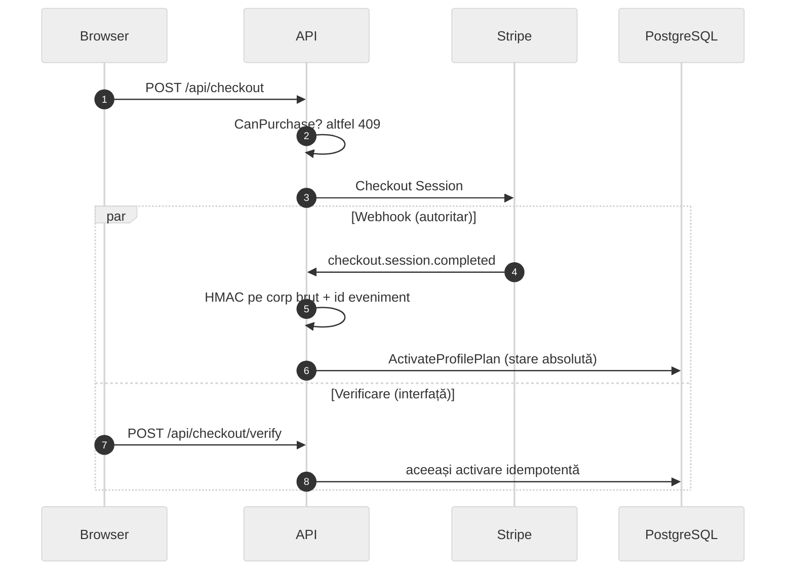
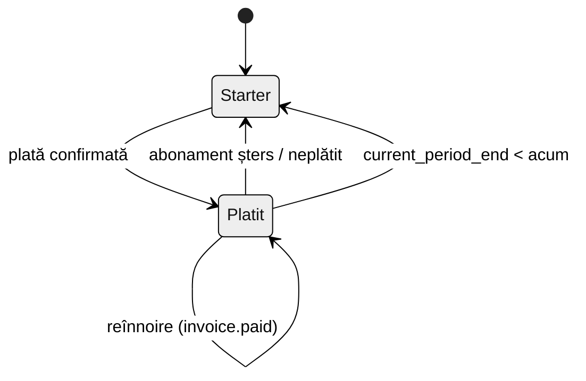

# Diagrame Mermaid — gata de export

**Export PNG/SVG de înaltă rezoluție:**
- online: https://mermaid.live → *Actions* → *PNG* / *SVG*. Pentru Word, folosiți PNG cu lățimea de 2400 px;
- din linia de comandă (necesită Node): `npx -p @mermaid-js/mermaid-cli mmdc -i diagrama.mmd -o figura.png -w 2400 -b white`.

Pentru documentul final, exportați pe fundal alb, cu tema `neutral`, ca diagramele să se potrivească stilului monocrom al aplicației.

---

## Figura 3.1 — Contextul sistemului (C4, nivelul 1)

## Figura 3.2 — Containere (C4, nivelul 2)

## Figura 3.3 — Straturile Clean Architecture

## Figura 3.4 — Modelul entitate-relație

## Figura 3.5 — Autentificarea JWT

## Figura 4.1 — Pipeline-ul de generare AI

## Figura 4.2 — Portalul public

## Figura 4.3 — Activarea abonamentului Stripe

## Figura 4.4 — Ciclul de viață al planului și al cotei

