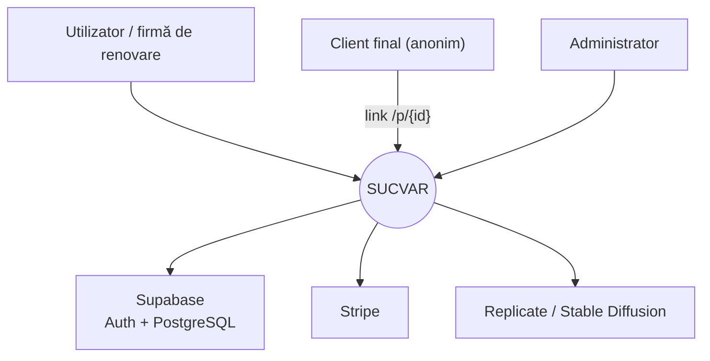
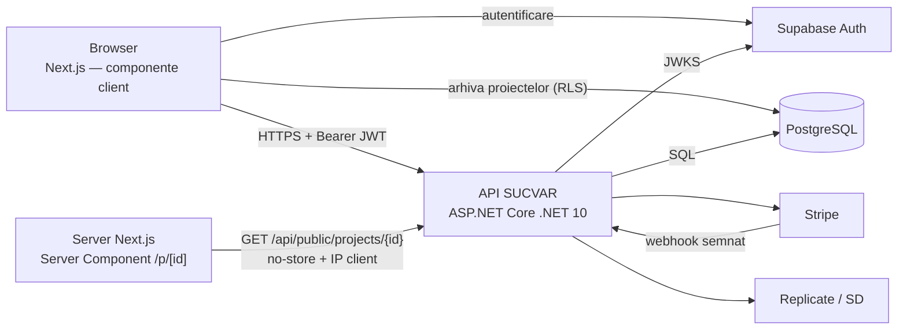
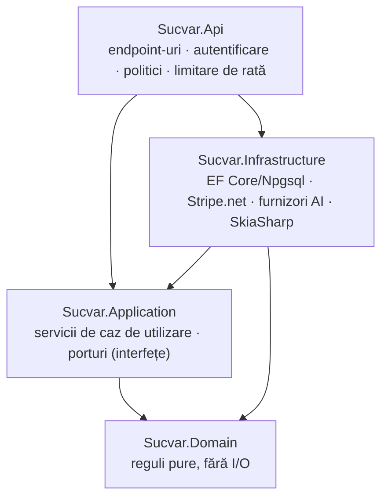
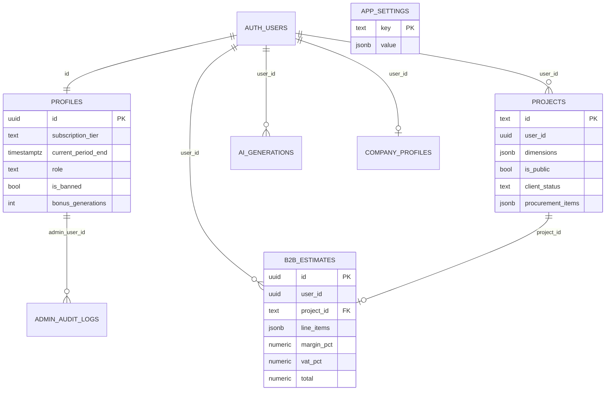
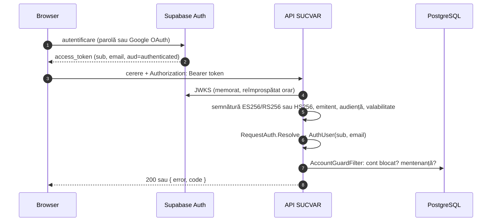

# Capitolul 3. Arhitectura sistemului și modelarea datelor

## 3.1 Vedere de ansamblu (modelul C4)

Arhitectura este descrisă pe primele două niveluri ale modelului C4 propus de Simon Brown: contextul sistemului și containerele.

**Nivelul 1 — Contextul.** SUCVAR interacționează cu patru categorii de actori umani (utilizator Studio, firmă B2B, client final anonim, administrator) și cu trei sisteme externe: Supabase (autentificare și bază de date), Stripe (plăți) și furnizorul de inferență AI (Replicate sau un server Stable Diffusion propriu).

*Figura 3.1 — Diagrama de context (C4, nivelul 1).*

**Nivelul 2 — Containerele.** Sistemul are două containere executabile și un depozit de date. Aplicația Next.js rulează în browser (componente client) și pe un server Node (componente server, folosite de portalul public). API-ul ASP.NET Core este singurul container care deține secrete și singurul care scrie în baza de date, cu o excepție controlată: arhiva de proiecte a utilizatorului este citită și scrisă din browser direct în Supabase, protejată de RLS (secțiunea 3.5).

*Figura 3.2 — Diagrama de containere (C4, nivelul 2).*

## 3.2 Arhitectura stratificată a serverului

Serverul respectă principiile Clean Architecture formulate de Robert C. Martin: dependențele de cod sursă sunt orientate exclusiv spre interior, iar regulile de business nu cunosc detaliile de infrastructură. Soluția `Sucvar.Api.slnx` conține patru proiecte de producție și un proiect de test.

*Figura 3.3 — Straturile serverului și direcția dependențelor.*

**Sucvar.Domain** conține reguli deterministe, fără acces la rețea, disc sau bază de date:

- `PlanTiers`: planuri, rang, nivelul efectiv și garda anti-dublă-facturare `CanPurchase`;
- `SucvarCatalog`: spații, stiluri, scenarii, încărcat dintr-un `catalog.json` inclus ca resursă;
- `Engineering`: geometria încăperii;
- `GenerationPrompt` și `DesignVision`: sinteza promptului;
- `BomBuilder` și `FrenchRetail`: lista de materiale și legăturile către retaileri;
- `EstimateParser` și `CompanyProfileParser`: validarea devizelor și a identificatorilor fiscali;
- `PublicProjection`: proiecția portalului public.

Clasa `Js` reproduce semantica numerică JavaScript (`Number(x)`, `Math.round`, `toFixed`), condiție necesară pentru ca portarea regulilor din TypeScript să producă rezultate identice la nivel de octet.

**Sucvar.Application** definește cazurile de utilizare și porturile de care acestea au nevoie:

- servicii: `QuotaService`, `SubscriptionService`, `CheckoutService`, `StripeWebhookProcessor`, `EstimateService`, `PortalService`, `ProfileService`, `ProcurementService`, `AdminService`, `PlatformSettingsService`;
- porturi: `ISubscriptionRepository`, `IEstimateRepository`, `IPortalRepository`, `IStripeGateway`, `IImageProvider` etc.

Eșecurile previzibile sunt semnalate printr-o singură excepție tipată, `AppException(status, code, message)`.

**Sucvar.Infrastructure** implementează porturile: depozitele EF Core peste `SucvarDbContext`, `StripeGateway` (adaptor anti-corupție peste Stripe.net), furnizorii AI și `SkiaImageProcessor`. Clasa `PgErrors` traduce codurile de eroare PostgreSQL în coduri stabile ale API-ului. De exemplu, o tabelă inexistentă produce 503 `MIGRATION_REQUIRED`, iar o încălcare de unicitate produce 409 `CONFLICT`.

**Sucvar.Api** este rădăcina de compunere. Rutele sunt grupate pe zone funcționale:

- `StudioEndpoints`: `/api/generate`, `/api/analyze-materials`;
- `BillingEndpoints`: checkout, verificare, portal de facturare, webhook;
- `B2bEndpoints`: devize și profilul firmei;
- `PortalEndpoints`: partajare, aprovizionare, portal public;
- `ProfileEndpoints`;
- `AdminEndpoints`.

Tot aici se află validarea JWT, politica `AdminOnly`, filtrul `AccountGuardFilter` și limitatorul `FixedWindowRateLimitStore`.

Direcția dependențelor este verificată de compilator: `Sucvar.Domain` nu referențiază niciun alt proiect, iar `Sucvar.Application` nu referențiază `Sucvar.Infrastructure`. Un fișier comun `Directory.Build.props` impune tuturor proiectelor analiza de nulabilitate cu avertismentele tratate ca erori și generarea documentației XML.

## 3.3 Organizarea aplicației client

Aplicația Next.js folosește App Router. Rutele principale sunt:

- `/`: prezentare și prețuri;
- `/generate`: Studio;
- `/b2b`: portalul firmei;
- `/account`, `/login`;
- `/admin`;
- `/checkout`;
- `/p/[id]`: portalul public al clientului.

Componentele sunt grupate pe funcționalități (`components/studio`, `b2b`, `portal`, `home`, `admin`, `account`), iar logica nevizuală stă în `app/lib`. Toate apelurile HTTP trec prin `lib/api-client.ts`, care alege adresa de bază (`NEXT_PUBLIC_API_URL` în browser, `API_INTERNAL_URL` pe server), atașează tokenul Supabase și normalizează răspunsurile de eroare la contractul `{ error, code }`.

Paginile mari păstrează starea și fluxurile asincrone, iar secțiunile vizuale sunt componente controlate, fără stare proprie (`PhotoSection`, `PricingConsole`, `PricingSection`). Interfața oglindește câteva reguli pure (catalogul, formulele de inginerie, planurile) pentru a reacționa instantaneu. Aceste reguli au rol strict informativ: serverul le reevaluează la fiecare cerere.

## 3.4 Modelul relațional și evoluția schemei

Schema aparține fișierelor SQL din `backend/db/migrations`. EF Core este folosit doar pentru interogări tipate și nu generează și nu aplică migrări. Fiecare migrare este idempotentă (`create table if not exists`, `add column if not exists`), astfel încât poate fi rulată repetat fără pierderi de date.

**Tabelul 3.1 — Migrările bazei de date**

| Migrare | Conținut |
|---|---|
| `001_sucvar_schema.sql` | `profiles`, `projects`, `ai_generations`, `b2b_estimates`; politici RLS; trigger `set_updated_at` |
| `002_public_portal.sql` | `projects.is_public`, `client_status`, `client_feedback`, `client_reviewed_at` |
| `002b_billing_period.sql` | `current_period_end`, `billing_interval`, `cancel_at_period_end` în `profiles` |
| `003_company_profile_and_vat.sql` | tabela `company_profiles` (identitatea firmei de pe deviz) |
| `004_user_profile_details.sql` | nume, avatar, valori implicite B2B (monedă, TVA, marjă) |
| `005_admin_panel.sql` | `role`, `is_banned`, `bonus_generations`, `quota_reset_at`; tabelele `admin_audit_logs` și `app_settings` |
| `006_project_procurement_items.sql` | `projects.procurement_items jsonb` (lista de materiale salvată) |
| `007_french_market_defaults.sql` | TVA implicită 20 %, regiunea implicită `paris` |

*Figura 3.4 — Modelul entitate-relație (extras).*

**Decizii de modelare.** Schema este normalizată pentru entitățile cu identitate proprie (utilizator, proiect, deviz, firmă). Pentru structurile care se citesc și se scriu întotdeauna împreună cu părintele lor, se folosește `jsonb`: liniile devizului, cotele încăperii împreună cu brief-ul Studio, lista de materiale. Alegerea evită tabele de legătură care nu ar fi interogate niciodată independent și păstrează atomicitatea salvării.

Indexul unic parțial `(user_id, project_id) where project_id is not null` pe `b2b_estimates` garantează un singur deviz per proiect și per proprietar. Pe această constrângere se bazează strategia de salvare „actualizează sau inserează” din `EstimateService`.

Tabela `projects` precede migrarea 001, astfel că, în unele baze de date, `created_at` a rămas de tip `text`. Clasa `ProjectSql` citește această coloană prin SQL explicit, cu conversie, ceea ce face codul compatibil cu ambele variante de schemă.

## 3.5 Izolarea datelor între utilizatori

Izolarea este impusă pe două niveluri independente.

1. **Row Level Security.** RLS este activat pe toate tabelele. Utilizatorul autentificat citește, și pentru `projects` și `b2b_estimates` scrie, doar rândurile cu `user_id = auth.uid()`. Tabelele `admin_audit_logs` și `app_settings` revocă orice drept rolurilor `anon` și `authenticated`. Acest nivel protejează căile prin care browserul vorbește direct cu Supabase.
2. **Filtrare explicită în API.** API-ul se conectează cu un rol privilegiat, care ocolește RLS prin construcție. Fiecare metodă de depozit primește identificatorul apelantului, `AuthUser.Id`, extras din revendicarea `sub` a tokenului, și filtrează în SQL după `user_id`. Niciun identificator de utilizator nu este citit din corpul cererii, ceea ce elimină clasa de vulnerabilități IDOR (referință directă nesigură la obiect).

Dublarea este intenționată: o eroare de configurare într-un singur nivel nu expune datele altui utilizator.

## 3.6 Autentificarea prin JWT Supabase

*Figura 3.5 — Fluxul de autentificare.*

Validarea este configurată în `SupabaseAuthExtensions.AddSupabaseJwt`. Sunt acceptate simultan cheile asimetrice publicate de proiect la `/auth/v1/.well-known/jwks.json` și, opțional, secretul simetric HS256 al proiectelor mai vechi. Se verifică emitentul (`{url}/auth/v1`), audiența (`authenticated`) și durata de valabilitate, cu o toleranță de 30 de secunde.

Opțiunea `MapInboundClaims = false` dezactivează redenumirea revendicării `sub` în URI-ul lung `ClaimTypes.NameIdentifier`. Toate citirile din cod folosesc numele brute din Supabase, iar o mapare implicită ar fi produs un identificator vid fără nicio eroare vizibilă.

Rutele nu folosesc `RequireAuthorization()` generic, ci apelează explicit `RequestAuth.Require`. Motivul este păstrarea a trei stări distincte, de care interfața are nevoie pentru mesaje corecte: lipsa tokenului (401 `AUTH_REQUIRED`), token respins (401 `AUTH_INVALID`) și server neconfigurat (500 `NOT_CONFIGURED`).

## 3.7 Contractul de erori și politicile transversale

Orice eroare are forma `{ "error": string, "code": string, ...extra }`. Excepțiile `AppException` își păstrează statusul și codul, iar orice altă excepție este jurnalizată și ascunsă în spatele unui 500 generic, astfel încât detaliile SQL nu ajung la client.

Ordinea componentelor din pipeline este documentată în `Program.cs`:

1. tratarea excepțiilor;
2. CORS;
3. limitatorul global (600 de cereri pe minut per IP);
4. autentificarea;
5. autorizarea.

Peste limitatorul global se aplică regulile pe rută, de exemplu `generate:user` cu 6 cereri pe minut sau `portal:review:project` cu 3 cereri la 10 minute.

Adresa IP folosită ca cheie de limitare este citită din `X-Forwarded-For` numai dacă partenerul TCP este un proxy declarat în `Proxy:KnownProxies`. Fără această regulă, un atacator ar putea obține câte o fereastră nouă de limitare pentru fiecare cerere, falsificând antetul.
