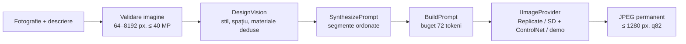
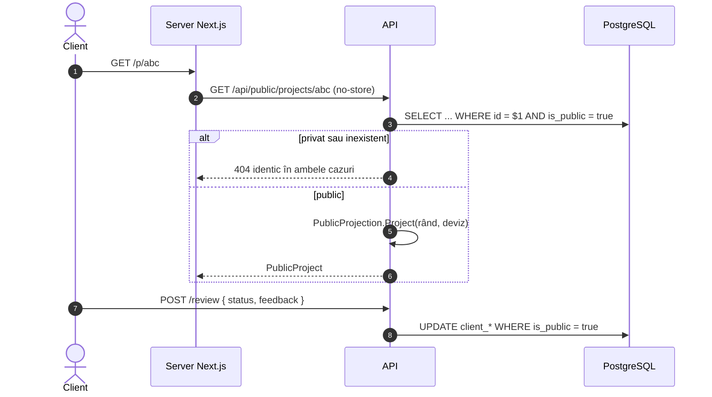

# Capitolul 4. Implementare și algoritmi

Capitolul descrie modulele care implementează obiectivele O1–O6. Pentru fiecare modul sunt prezentate datele de intrare, algoritmul, deciziile de proiectare și clasele care îl realizează.

## 4.1 Studioul AI: sinteza promptului și păstrarea structurii

### 4.1.1 Fluxul unei generări

O cerere `POST /api/generate` conține fotografia ca Data URL (JPEG, PNG sau WebP), modul (`interiors`, `exteriors` sau `gardens`), tipul spațiului, cotele încăperii și, opțional, o descriere liberă (`customPrompt`, cel mult 1000 de caractere), o paletă, un tip de iluminare și indicatorul `preserveStructure`.

Ordinea verificărilor din `StudioEndpoints` este dictată de cost: fiecare cerere respinsă înainte de apelul către furnizor este gratuită.

1. limitare de rată per IP (`generate:ip`, 30 de cereri pe minut);
2. verificarea cotei (`QuotaService.CheckAsync`): sesiune, plan efectiv, consum lunar;
3. limitare de rată per utilizator (`generate:user`, 6 cereri pe minut);
4. plafonul corpului cererii (6 000 000 + 100 000 de octeți);
5. validarea imaginii: prefixul Data URL este verificat caracter cu caracter, fără expresie regulată peste 6 MB, iar antetul imaginii este citit fără decodare completă; latura trebuie să fie între 64 și 8192 px, cu cel mult 40 de megapixeli;
6. sinteza promptului în `GenerationPrompt` și `DesignVision`;
7. apelul furnizorului prin `IImageProviderSelector`;
8. conversia rezultatului într-un JPEG permanent (cel mult 1280 px lățime, calitate 82);
9. înregistrarea în `ai_generations`, făcută numai după ce furnizorul a returnat o imagine.


*Figura 4.1 — Etapele pipeline-ului de generare.*

### 4.1.2 Interpretarea descrierii libere

`DesignVision` normalizează textul (litere mici, fără diacritice) și extrage trei categorii de informații:

- **stilul**, dacă utilizatorul nu a ales unul explicit (`InferStyle`);
- **tipul spațiului**, de exemplu „bucătărie” în modul interior (`InferSpace`);
- **materialele recunoscute** (`DetectMaterials`): stejar, nuc, travertin, marmură, microciment, var, șipci de lemn, cărămidă aparentă, benzi LED etc.

Fiecare material recunoscut are un echivalent englezesc folosit în prompt și un „slot” în lista de materiale. Textul românesc este tradus printr-un glosar de descriptori. Textul englezesc este transmis aproape neschimbat, după eliminarea sintaxei de ponderare specifice Stable Diffusion, precum `(word:1.5)`, care ar permite utilizatorului să manipuleze ponderile modelului.

### 4.1.3 Construcția promptului sub buget de tokeni

Encoderul CLIP al modelelor Stable Diffusion procesează cel mult 77 de tokeni, iar restul textului este trunchiat. Platforma lucrează cu un buget de 72 de tokeni (`AiLimits.MaxPromptTokens`) și estimează numărul de tokeni ai unui șir conservator, fără tokenizator:

$$T(s) = \lceil 1{,}25 \cdot n_{cuvinte}(s) + n_{virgule}(s) \rceil$$

`SynthesizePrompt` produce segmente în ordinea priorității:

1. scena compactă;
2. materialele recunoscute;
3. indicația de structură (`keep existing walls, windows and doors` sau `completely redesigned layout`);
4. cuvintele utilizatorului;
5. paleta;
6. iluminarea;
7. stilul;
8. scenariile și nivelul de intervenție;
9. dispunerea mobilierului, doar când structura este păstrată;
10. detaliile de buget, doar în lipsa materialelor și a paletei;
11. directiva fotografică finală, care este păstrată întotdeauna.

`BuildPrompt` adaugă segmentele cât timp bugetul permite. Dacă un segment nu încape întreg, `FitSegment` elimină termeni de la coada lui, nu de la început. Astfel, informațiile cu prioritate mare nu sunt niciodată sacrificate în favoarea celor cu prioritate mică, iar termenii duplicați sunt eliminați la combinare.

### 4.1.4 Intensitatea transformării și păstrarea structurii

Glisorul „intensitate” (40–100 %) este transformat în parametrul `prompt_strength` al modelului img2img:

$$p_0 = \min\left(0{,}9,\ \max\left(0{,}45,\ \frac{s}{100}\right)\right)$$

Pe calea „smart”, indicatorul `preserveStructure` impune o limită suplimentară:

$$p = \begin{cases} \min(p_0,\ 0{,}8) & \text{dacă structura se păstrează} \\ \max(p_0,\ 0{,}8) & \text{dacă se cere reproiectare} \end{cases}$$

La păstrarea structurii se adaugă în promptul negativ termeni care penalizează mutarea pereților și a ferestrelor. Pe furnizorul Stable Diffusion local, ControlNet în modul `mlsd` condiționează suplimentar generarea pe segmentele drepte detectate în fotografie.

Cererile vechi, care conțin doar `styleId`, `dimensions` și `ai`, produc exact promptul istoric. Comportamentul este verificat de testele de paritate.

### 4.1.5 Selecția furnizorului și reziliența

`ImageProviderSelector` alege furnizorul din configurație: explicit prin `Ai:Provider`, altfel Stable Diffusion dacă există un URL, apoi Replicate dacă există un token, iar în ultimă instanță un furnizor demonstrativ care nu consumă credit.

Clienții HTTP folosesc politicile standard de reziliență, cu o restricție importantă: reîncercările sunt dezactivate pentru metodele nesigure. O cerere POST reîncercată către Replicate ar factura de două ori aceeași generare.

## 4.2 Motorul parametric de geometrie

Clasa `Engineering` calculează mărimile tehnice ale unei încăperi paralelipipedice din lățimea $W$, lungimea $L$, înălțimea $H$, numărul de uși $n_u$ și numărul de ferestre $n_f$. Valorile de intrare sunt mai întâi aduse în intervale valide de `DimensionSanitizer`: lățimea și lungimea între 1 și 100 m, înălțimea între 2 și 6 m la interior, ușile între 0 și 20.

**Tabelul 4.1 — Formulele motorului de geometrie**

| Mărime | Formulă | Constante |
|---|---|---|
| Suprafața pardoselii | $A = W \cdot L$ | rotunjire la 2 zecimale |
| Volum | $V = A \cdot H$ | |
| Perimetru | $P = 2(W + L)$ | |
| Arie netă de perete | $A_p = \max(0,\ P \cdot H - 1{,}89\,n_u - 2{,}1\,n_f)$ | ușă 1,89 m², fereastră 2,1 m² |
| Pardoseală cu pierderi | $A_{pd} = 1{,}10 \cdot A$ | 10 % pierderi la tăiere |
| Vopsea | $\lceil A_p \cdot 2 / 10 \cdot 1{,}1 \rceil$ L | 2 straturi, 10 m²/L, rezervă 10 % |
| Plintă | $\max(0,\ P - 0{,}9\,n_u) \cdot 1{,}05$ ml | lățime ușă 0,9 m, rezervă 5 % |
| Flux luminos necesar | $\Phi = E \cdot A / (0{,}6 \cdot 0{,}9)$ lm | metoda fluxului: utilizare 0,6, mentenanță 0,9 |
| Corpuri de iluminat | $\max(1,\ \lceil \Phi / 800 \rceil)$ | 800 lm per corp |
| Plăci de gips-carton | $\lceil 1{,}1 \cdot A / 3{,}0 \rceil$ | placă 1,2 × 2,5 m, pierderi 10 % |
| Profile de plafon | $\lceil 3{,}2 \cdot A \cdot 1{,}05 \rceil$ ml | 3,2 ml/m² |
| Suspensii | $\lceil 1{,}5 \cdot A \rceil$ buc. | 1,5 buc./m² |

Iluminarea medie țintă $E$ (în lucși) este preluată din catalog pentru fiecare tip de spațiu. Mărimile de plafon se calculează doar în modul interior.

Rotunjirile urmează semantica JavaScript `toFixed`, reprodusă de `Js.ToFixedString` printr-o expansiune zecimală exactă, deoarece conversia implicită `decimal(double)` păstrează doar 15 cifre semnificative.

Toate formulele sunt pure. Același calcul alimentează panoul „Specificații inginerești” din Studio, lista de materiale și varianta tipăribilă, ceea ce exclude divergențele între documente.

## 4.3 Lista de materiale și aprovizionarea multi-retailer

`BomBuilder` construiește, determinist, lista de materiale a unei încăperi din cinci intrări: mod, spațiu, stil, cote și nivel de intervenție.

**Selecția articolelor.** Fiecare spațiu are un „kit” de articole: șapă, pardoseală, faianță la spațiile umede, vopsea, plintă, plafon, iluminat, mobilier. Stilul determină materialul concret, de exemplu parchet de stejar uleiat la stilul japandi sau terrazzo la cel contemporan. Spațiile umede (baie, bucătărie) primesc gresie antiderapantă R10 și vopsea antimucegai, cu excepția stilurilor care folosesc deja un material rezistent la apă.

**Cantitățile** provin din motorul de geometrie: pardoseala din $A_{pd}$, vopseaua din $A_p$, iar la exterior termoizolația din $A_p \cdot 1{,}05$. Fiecare cantitate este scalată cu ponderea nivelului de intervenție (`Share`) și rotunjită în sus.

**Prețurile** sunt prețuri medii de raft, scalate cu un coeficient de buget: 0,8 pentru economic, 1,0 pentru standard și 1,6 pentru lux.

Când descrierea liberă conține materiale recunoscute, acestea înlocuiesc articolul generic din slotul lor sau sunt adăugate ca articole noi. Ele sunt marcate `fromPrompt` și listate primele.

**Rutarea pe retaileri.** Interogarea de căutare este tradusă în franceză, iar `FrenchRetail.Lane` clasifică articolul pe o „bandă” de aprovizionare, prin căutarea unor rădăcini lexicale specifice materialelor de șantier: *plaque de plâtre*, *ragréage*, *carrelage*, *gravier* etc.

**Tabelul 4.2 — Benzile de aprovizionare**

| Bandă | Retaileri, în ordinea afișării |
|---|---|
| materiale de construcție | Point.P · La Plateforme du Bâtiment · Brico Dépôt |
| finisaje | Leroy Merlin · Castorama · ManoMano |
| mobilier | IKEA France · ManoMano · Castorama |
| iluminat | IKEA France · Leroy Merlin · ManoMano |
| exterior — construcții | Brico Dépôt · La Plateforme du Bâtiment · Leroy Merlin |
| exterior — amenajare | Leroy Merlin · Castorama · ManoMano |

Legăturile sunt reconstruite întotdeauna pe server din interogare și nu sunt copiate din JSON-ul stocat. Un rând modificat manual în baza de date nu poate injecta o adresă arbitrară în pagina clientului. Lista calculată la salvare este persistată în `projects.procurement_items` (migrarea 006). Pentru proiectele mai vechi, `ProcurementService.BackfillAsync` o recalculează din parametrii salvați.

## 4.4 Devizul B2B și localizarea pentru piața franceză

Portalul `/b2b` este disponibil pe planul Business sau administratorilor. Poarta este impusă pe server de `B2bEndpoints.RequireAgency`.

**Calculul devizului.** Pentru fiecare meserie $m$ (finisaje, electrice, gips-carton, instalații), cu suprafața de lucru $S_m$, normativul de ore $h_m$ și tariful orar regional $r_m$, se calculează:

$$\text{ore}_m = S_m \cdot h_m \cdot k_{finisaj}, \qquad M = \sum_m \text{ore}_m \cdot r_m$$

Coeficientul $k_{finisaj}$ depinde de nivelul de finisaj. Fie $B$ suma liniilor de materiale (cantitate × preț de achiziție). Atunci:

$$\text{baza} = M + B,\quad C = \text{baza} \cdot c,\quad \text{Marjă} = (\text{baza} + C) \cdot m$$
$$HT = \text{baza} + C + \text{Marjă},\qquad TVA = HT \cdot t,\qquad TTC = HT + TVA$$

Contingența $c$ este cuprinsă între 0 și 15 %, marja $m$ între 10 și 25 %, iar $t$ este cota de TVA. Durata lucrării este $\lceil \sum \text{ore}_m / (8 \cdot n_{echipă}) \rceil$ zile lucrătoare.

**Tabelul 4.3 — Elemente de localizare pentru Franța**

| Element | Implementare |
|---|---|
| TVA 20 % (taux normal) | valoare implicită în interfață (`DEFAULT_VAT`), pe server (`EstimateDefaults.VatPct`) și în baza de date (migrarea 007) |
| TVA 10 % (rénovation, locuință > 2 ani) | presetare cu un clic (`VAT_PRESETS`) |
| Regiuni tarifare | Paris intra-muros, Petite couronne (92 · 93 · 94), Grande couronne (77 · 78 · 91 · 95); implicit `paris` |
| SIREN / SIRET | algoritmul Luhn pe 9 sau 14 cifre; excepția La Poste (SIREN 356000000), validată prin suma cifrelor modulo 5 |
| N° TVA intracommunautaire | `FR` + cheie + SIREN; cheia numerică $= (12 + 3 \cdot (SIREN \bmod 97)) \bmod 97$ |
| IBAN | ISO 13616, mod 97; 27 de caractere pentru FR |
| Export | CSV și XML Factur-X / CII (EN 16931) pentru încorporare într-un PDF/A-3 |

Validarea are loc pe server în `CompanyProfileParser` și `EstimateParser`. Acestea tratează corpul cererii ca intrare nesigură: identificatorul proiectului este verificat cu tiparul `^[\w.:-]{1,128}$`, un deviz are cel mult 500 de linii, iar valorile numerice sunt limitate la intervale admise.

## 4.5 Portalul public al clientului

Clientul final deschide `/p/{id}` fără cont. Pagina este o componentă server Next.js care cere proiectul de la `GET /api/public/projects/{id}` cu `cache: 'no-store'`, astfel încât retragerea linkului are efect la cererea imediat următoare. Componenta transmite și adresa IP a vizitatorului, pentru limitarea de rată. În browser ajunge doar obiectul `PublicProject`, deja filtrat.


*Figura 4.2 — Citirea și aprobarea în portalul public.*

**Proiecția prețurilor.** Când există un deviz B2B, `PublicProjection.Pricing` transformă fiecare preț de achiziție în preț final pentru client:

$$p_{client} = p_{achiziție} \cdot (1 + c) \cdot (1 + m)$$

Este exact modul în care portalul B2B distribuie proporțional contingența și marja pe liniile facturii. Manopera afișată este diferența dintre totalul fără TVA și materiale, iar TVA-ul este diferența dintre total și totalul fără TVA.

Dacă devizul este parțial sau neactualizat, factorul de majorare este plafonat astfel încât materialele să nu depășească totalul fără TVA. Clientul nu vede niciodată marja, contingența, prețul de achiziție, notele interne sau datele de contact ale firmei.

**Garanții suplimentare:**

- proiectele private și cele inexistente primesc același răspuns 404, deci un atacator nu poate enumera identificatori;
- recenzia trece prin validări ordonate: identificator, limitare de rată per IP și per pereche (IP, proiect), tip de conținut JSON, mărime, câmpuri;
- mesajul clientului este curățat de caracterele de control C0/C1 și limitat la 500 de caractere;
- singurele coloane care pot fi scrise anonim sunt `client_status`, `client_feedback` și `client_reviewed_at`, și doar pe proiecte publice.

## 4.6 Ciclul de facturare Stripe

Planul efectiv nu este o valoare stocată, ci rezultatul unei funcții evaluate la fiecare citire:

$$\text{nivel}_{efectiv} = \begin{cases} \text{starter} & \text{dacă nivelul plătit are } current\_period\_end < acum \\ \text{nivel stocat} & \text{altfel} \end{cases}$$

Un webhook pierdut nu poate prelungi astfel un abonament expirat.

```mermaid
sequenceDiagram
    autonumber
    participant B as Browser
    participant API as API
    participant S as Stripe
    participant DB as PostgreSQL
    B->>API: POST /api/checkout {plan, interval}
    API->>API: CanPurchase? altfel 409
    API->>S: Checkout Session (metadata user_id, plan)
    par Calea autoritară
        S->>API: checkout.session.completed (semnat)
        API->>API: HMAC pe corpul brut; id eveniment deja procesat?
        API->>DB: ActivateProfilePlan (stare absolută)
    and Calea de interfață
        B->>API: POST /api/checkout/verify
        API->>DB: aceeași activare idempotentă
    end
```
*Figura 4.3 — Activarea abonamentului.*

**Idempotența** este asigurată pe trei niveluri:

1. `StripeWebhookProcessor` reține identificatorii evenimentelor procesate timp de 48 de ore și îi marchează numai după succes, astfel încât un eveniment eșuat este reîncercat de Stripe;
2. operațiile scriu stare absolută (plan, identificatori, sfârșitul perioadei), niciodată incremente, deci reluarea unui eveniment nu modifică rezultatul;
3. retrogradarea se aplică doar dacă abonamentul din eveniment este încă abonamentul curent al profilului, astfel încât un eveniment `customer.subscription.deleted` sosit în altă ordine nu anulează un plan mai nou.

Semnătura este verificată pe corpul brut, citit înainte de orice deserializare, deoarece HMAC-ul acoperă exact octeții trimiși de Stripe.

**Garda anti-dublă-facturare** `CanPurchase` permite doar o îmbunătățire: orice plan de la `starter`, un rang superior, sau trecerea de la lunar la anual pe același plan. Altfel răspunde 409 `ALREADY_SUBSCRIBED` sau `PLAN_INCLUDED`.

**Cota de utilizare.** Pentru planul gratuit, limita și consumul se calculează astfel:

$$\text{limita} = L_{plan} + \text{bonus},\qquad \text{consum} = \max(n_{proiecte},\ n_{generări})$$

Ambele numărători pornesc de la cea mai recentă dintre două date: începutul lunii UTC și ultima resetare făcută de un administrator. Maximul, nu suma, evită dubla numărare a unei randări care a fost și jurnalizată, și salvată. `QuotaService` eșuează închis: dacă numărarea nu reușește, generarea este refuzată. `SubscriptionService` eșuează sigur: dacă planul nu poate fi citit, se aplică regulile planului gratuit.

## 4.7 Panoul de administrare

Rutele `/api/admin/**` cer politica `AdminOnly`. `AdminAuthorizationHandler` recitește `profiles.role` și `profiles.is_banned` din PostgreSQL la fiecare cerere. Rolul nu este inclus în JWT, deoarece un token emis înainte de retrogradare ar fi păstrat drepturile până la expirare. Eșecurile de autorizare sunt transformate de `JsonAuthorizationResultHandler` în același contract `{ error, code }`, cu codurile `ADMIN_REQUIRED`, `ACCOUNT_BANNED` și `ADMIN_CHECK_FAILED`.

`AdminService.UpdateUserAsync` aplică modificările de plan, de cotă, de rol și de blocare. Pentru fiecare câmp care se schimbă efectiv construiește o intrare de audit cu valorile anterioare și noi. `IAdminRepository.ApplyUserChangesAsync` scrie modificările și jurnalul în aceeași tranzacție, astfel încât jurnalul nu poate contrazice datele.

Un administrator nu își poate bloca propriul cont și nu își poate retrage rolul (400 `SELF_PROTECTION`). Platforma nu poate rămâne astfel fără administratorul care execută acțiunea.

Setările platformei (limitele planurilor, prețurile afișate, modul de mentenanță, permiterea înregistrărilor) stau în `app_settings`. Sunt editabile fără redeplasare și memorate 30 de secunde pe instanță de `SettingsCache`. `AccountGuardFilter` folosește aceste setări pentru a răspunde 503 `MAINTENANCE` tuturor utilizatorilor, cu excepția administratorilor. Rutele de profil, portal de facturare, verificare a plății și webhook nu sunt blocate: un utilizator suspendat poate afla motivul și își poate anula abonamentul, iar o plată deja încasată este onorată întotdeauna.
